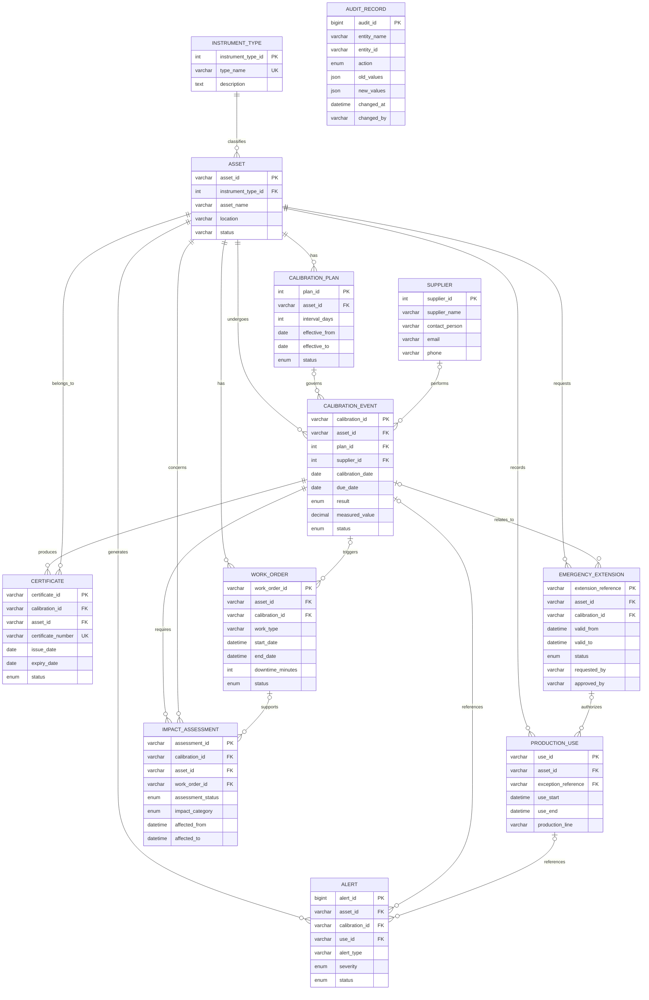

# Entity Relationship Diagram
## Calibration Management and Production Compliance System

The database contains 12 entities. The diagram shows the primary relationships enforced by the database schema.

## Relationship notes

1. One instrument type can classify multiple assets.
2. One asset can have multiple calibration plans and calibration events.
3. A calibration event can optionally reference one calibration plan and one supplier.
4. A calibration event can have multiple certificates.
5. A failed calibration can be associated with corrective work orders and impact assessments.
6. An asset can have multiple production-use records and emergency extensions.
7. A production-use record can optionally reference one emergency extension.
8. Alerts reference an asset and can optionally reference a calibration event or production-use record.
9. Audit records store historical changes across entities.

## Special database constraints

- `calibration_event` has a composite unique key on `(calibration_id, asset_id)`.
- `certificate` uses a composite foreign key to ensure its asset matches its calibration event.
- `emergency_extension` also uses a composite foreign key to ensure the calibration belongs to the same asset.
- `calibration_event` uses a composite foreign key to ensure its selected plan belongs to the same asset.
- `audit_record` intentionally has no direct foreign key because it stores changes for multiple entity types.
